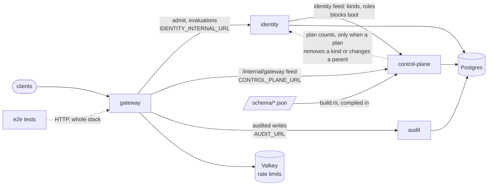
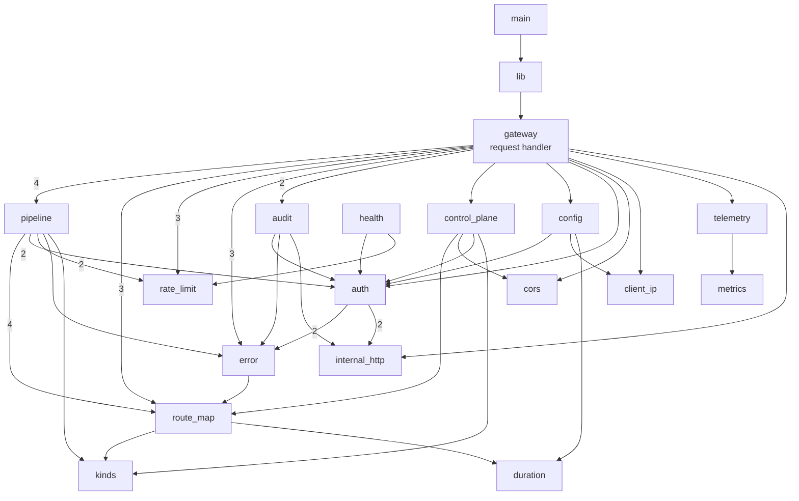
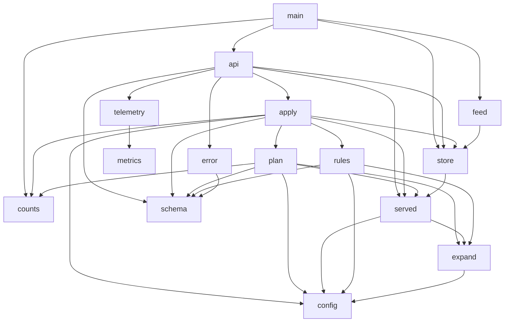
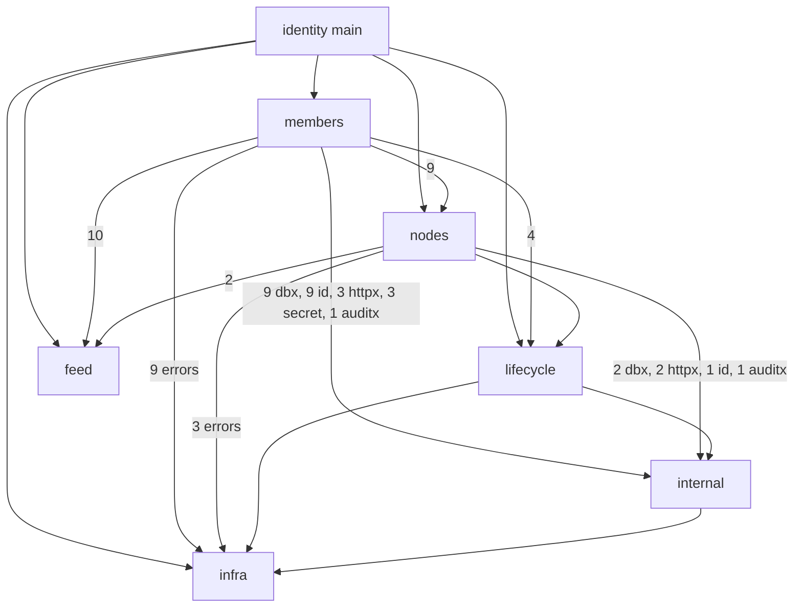
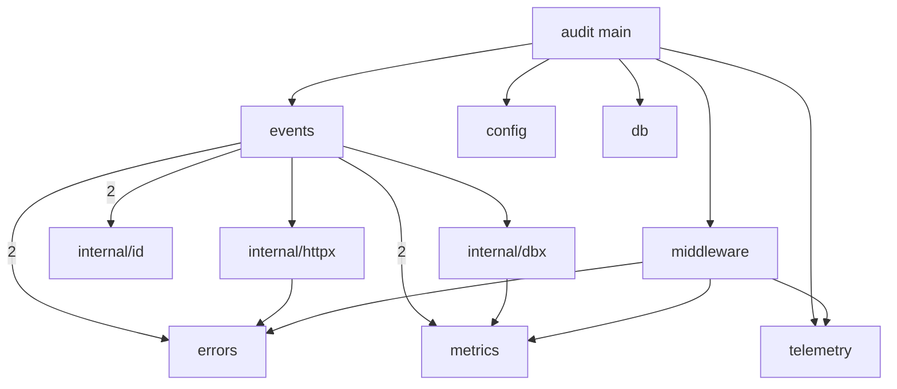

# Module map

- Date: 2026-11-09
- Commit: `3e36f28`, plus the uncommitted fixes listed under "Changes since last map"
- Scope: the whole repository. Four services, each released on its own: `services/gateway` and `services/control-plane` (Rust crates), `services/identity` and `services/audit` (Go modules). Plus `e2e` (a Go module with tests only) and `schema/` (JSON Schema, compiled into the control plane).
- How the edges were found: Go from `go list` (package imports), weighted by the number of non-test files that import the package. Rust by grepping `crate::<module>` in non-test code (code after `#[cfg(test)]` is cut off), weighted the same way. Service-to-service edges come from the env vars each service reads (`docs/reference/env.md`) and the internal APIs it calls (`docs/reference/api/internal.md`).
- Left out: tests, `target/`, third-party crates and packages. Notable externals: pgx (every Go package that touches the DB), fiber (every Go handler), pingora (gateway), OpenTelemetry (every service's `telemetry`).

There is no `docs/architecture.md`, so no layering has been declared. The layering used below is the one the code mostly follows already: wiring > handlers > domain > infrastructure leaves.

## 1. Services (runtime)

The dotted `control-plane → identity` edge closes a cycle with `identity → control-plane`. It is deliberate and documented: `docs/concepts/config.md#blocked-changes`.

## 2. gateway (Rust crate)

No cycles. `metrics` is used by `auth` (4 files), `gateway`, `pipeline`, `audit`, `control_plane` and `telemetry`; those edges are left out of the drawing. `route_map` now holds `upstream` (a route's upstream template, compiled when the route is built), and `pipeline` fills it per request.

## 3. control-plane (Rust crate)

No cycles. Test-only modules (`api_tests`, `docgen`, `fixtures`) are left out. Every edge has weight 1: each module is one file. `served` is the projection of a checked config into the two feed bodies. `apply` orchestrates (check, plan, write), `plan` compares two `Served`, and `store` persists them.

## 4. identity (Go module), packages grouped

`infra` = `config`, `db`, `errors`, `metrics`, `middleware`, `telemetry`. `internal` = `internal/httpx`, `internal/dbx`, `internal/id`, `internal/auditx`, `internal/secret` (`internal/testdb` is used only by tests).

## 5. audit (Go module)

No cycles. `events` is the only domain package.

## Modules

| Module | Responsibility | Depends on | Used by |
|---|---|---|---|
| **gateway** (service) | The public edge: routing, auth, rate limits, CORS, audit emission | identity, control-plane, audit, Valkey | clients, e2e |
| gw `gateway` | Pingora request handler: wires every module into the proxy | nearly every module | `lib` |
| gw `pipeline` | Per-request decision: admit, permissions, rate limits, upstream fill | route_map, auth, rate_limit, error, kinds, metrics | gateway |
| gw `route_map` | The route table built from the control-plane snapshot, each route's upstream template included | kinds, duration | gateway, pipeline, control_plane, error |
| gw `auth` | JWT validation, admit calls to identity | error, internal_http, metrics | gateway, pipeline, audit, config, control_plane, health |
| gw `control_plane` | Follows the control-plane feed, swaps in snapshots | route_map, cors, auth, kinds, metrics | gateway |
| gw `cors` | The CORS policy compiled from the control plane's `cors` document | none | gateway, control_plane |
| gw `client_ip` | Trusted proxies and the client IP and scheme they imply | none | gateway, config |
| gw `duration` | The duration format shared by env and config documents | none | config, route_map |
| gw `audit` | Sends audited writes to audit | auth, error, internal_http, metrics | gateway |
| gw `rate_limit`, `kinds`, `config`, `error`, `health`, `internal_http`, `metrics`, `telemetry` | Leaves and infrastructure | mostly none (`config` → auth, client_ip, duration; `error` → route_map) | many |
| **control-plane** (service) | Stores and validates the deployment's config, serves feeds | identity (counts), Postgres, `schema/` | gateway, identity |
| cp `api` | HTTP API: plan, apply, feeds | apply, store, schema, error, telemetry, metrics | main |
| cp `apply` | Checks a config, plans it against the head, writes the revision | plan, store, served, rules, schema, counts, config | api |
| cp `served` | The two feed bodies a revision serves, built from a checked config | expand, config | api, apply, plan, store |
| cp `plan` | Compares the head's served bodies with the new ones; blocked changes | served, expand, schema, counts, config | apply |
| cp `rules`, `expand`, `schema`, `config` | Config validation and expansion | schema, config, expand | apply, plan |
| cp `store` | Postgres storage of revisions | served | api, apply, feed, main |
| cp `feed`, `counts` | Long-poll feeds; HTTP client for identity's plan counts | store / none | main, apply, plan |
| **identity** (service) | The tree of nodes, principals, members, bindings, keys | control-plane (feed), Postgres | gateway, control-plane |
| id `members` | Users, people, service accounts, invites, bindings, admit, evaluations, internal API | nodes, lifecycle, feed, internal/*, errors, metrics | main |
| id `nodes` | Node tree, slugs, sweep, plan counts | lifecycle, feed, internal/*, errors, metrics | main, members |
| id `lifecycle` | The lifecycle event log | errors, internal/dbx, internal/httpx | main, members, nodes |
| id `feed` | Follows the control plane's identity feed | none | main, members, nodes |
| id `internal/*` | HTTP and DB helpers, ids, audit details, secrets | errors, metrics | members, nodes, lifecycle |
| id infra | config, db, errors, metrics, middleware, telemetry | none (middleware → errors, metrics, telemetry) | everything |
| **audit** (service) | Append-only audit log | Postgres | gateway |
| au `events` | Write and list audit events | errors, metrics, internal/* | main |
| **e2e** | Whole-stack tests over HTTP | the running stack | nobody |
| **schema/** | The config's JSON Schema | none | control-plane (build time) |

## Findings, most serious first

1. **`identity/members` has the highest fan-out of any module (10 packages) and is the largest (12 files, about 4,100 lines).** It holds four of the five tree concepts `AGENTS.md` names (principals, members, bindings, keys), plus the decision the gateway asks for on every request (`admit.go`, `evaluate.go`) and the internal API. Its dependency on `nodes` goes through the public API (`nodes.Get`, `nodes.LockedWritable`, `nodes.ErrNotFound`), so this is about size, not a broken boundary. Splitting one package per concept would likely add coupling, since bindings, members and principals are tightly linked.
   *Direction:* if it keeps growing, split decision from records: admit and evaluations in one package, member, invite and service-account writes in another. That is the split the gateway already makes between `pipeline` and the modules holding data.

2. **Identity and audit duplicate their infrastructure packages.** `telemetry` is 444 lines in each, with 4 lines different. `middleware` (340 lines, 48 different), `errors`, `metrics`, `internal/dbx`, `internal/httpx` and `internal/id` are near-copies too, and so are the two Rust crates' `telemetry.rs` (32 lines different). This is deliberate: `docs/decisions/config-and-apply.md` chooses "a contract test, not shared code" between services released apart. The cost is drift. A fix to trace propagation (`docs/reference/telemetry.md`) has to land four times.
   *Direction:* keep the decision, and add a check that fails when the Go copies diverge outside an allowed list, or accept the drift knowingly.

3. **The identity ⇄ control-plane cycle between services.** Identity won't listen until it has the control plane's first config. The control plane asks identity for plan counts. Only identity knows whether a kind is still in use, so this is real ownership, not a tangle. Boot can't deadlock, because counts are asked only when a plan removes a kind or changes a parent, and `docs/concepts/config.md` says so.
   *Direction:* none needed. Keep the "a plan that does neither never calls identity" rule covered by e2e, since that rule is what keeps boot order safe.

4. **Naming: the same job has two names.** Identity's follower of the control plane is the package `feed`; the gateway's is the module `control_plane`.
   *Direction:* unify the names when either is next touched.

5. **High fan-in modules are small, stable leaves.** In the gateway, `auth` has 6 users and `metrics` 7. Some reach into `auth`'s submodules (`auth::jwt::Audiences`, `auth::admit::NodeRef`), but those are declared `pub mod`, so they are `auth`'s public interface, not its internals. In identity, `errors` and `internal/dbx` are used by every domain package. This is what high fan-in should look like.

6. **No orphaned or dead modules.** `identity/internal/testdb` and the control plane's `docgen` and `fixtures` are test-only on purpose. `e2e` has no non-test code by design.

## Changes since last map

Compared with the first map (same date, commit `3e36f28`, before the fixes):

- **Gateway: four cycles removed.** Each was a type in the wrong module, and each move follows what the type is:
  - `cors` (`CorsPolicy`) and `client_ip` (`TrustedProxies`) moved from `gateway/` to top-level modules. `config` and `control_plane` no longer import the request handler.
  - `Upstream` moved from `pipeline/fill.rs` into `route_map/upstream.rs`, because it is part of a route. `path_and_query`, which builds the forwarded URI, moved to `gateway/upstream.rs`, its only user. `route_map → pipeline` is gone.
  - `parse_duration` moved from `config` to a new `duration` module. The first map missed the cycle `route_map → config → auth → error → route_map`, and this removes it.
  - `error → route_map` stays. An error describing what a route required is the right direction, and it was only in a cycle because of `route_map → pipeline`.
- **Control plane: two cycles removed.** `Served`, `gateway_body`, `identity_body` and `feed_body` moved from `apply` to a new `served` module. `plan → apply` and `store → apply` are gone.
- **Findings dropped:** the two cycle findings (fixed), and the claim that modules reach into `auth`'s internals (its submodules are public).
- **Findings added:** the `feed` / `control_plane` naming.
