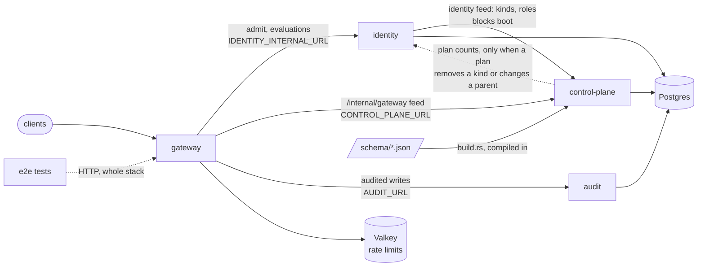
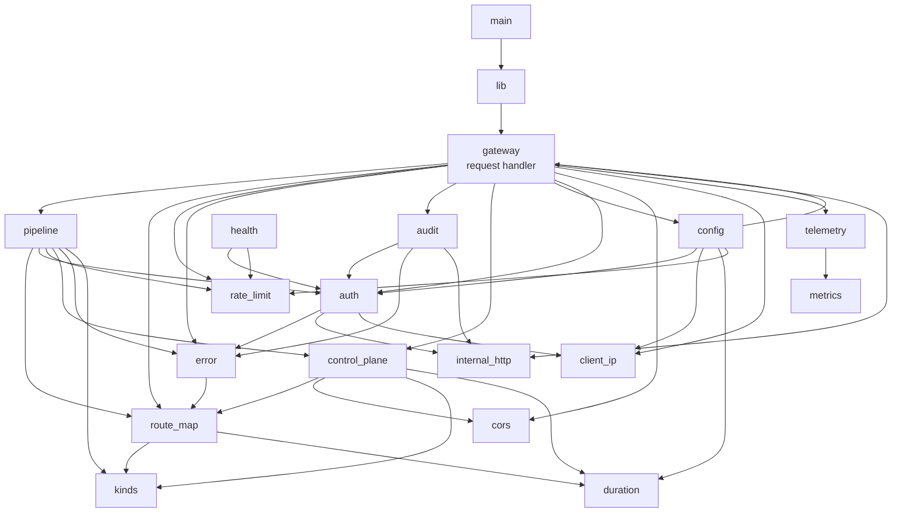
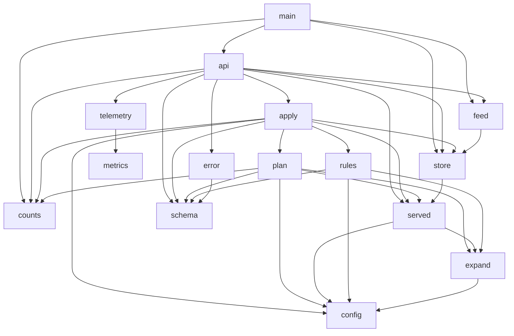
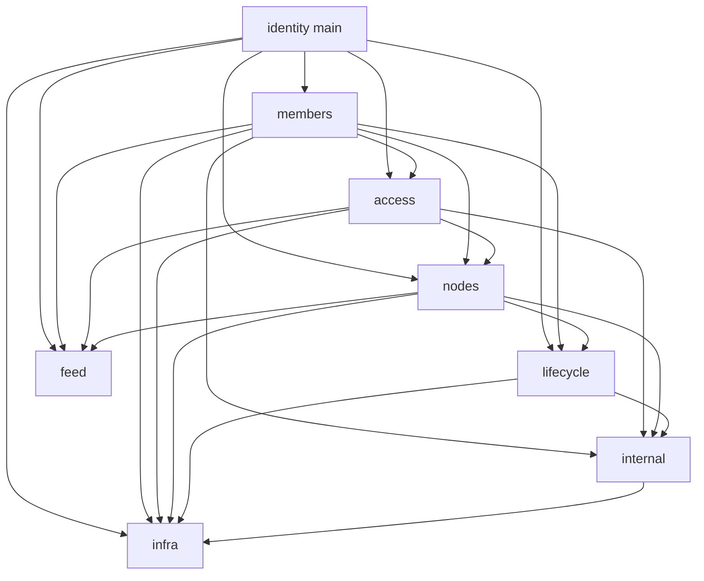
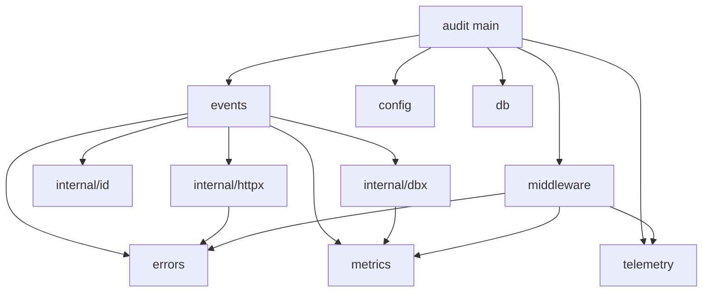

# Module map

Internal dependency structure of the four Plat5 services (`services/gateway` and `services/control-plane` in Rust, `services/identity` and `services/audit` in Go), `e2e`, and `schema/`. Layering follows: wiring → handlers → domain → infrastructure leaves.

## 1. Services (runtime)

The dotted `control-plane → identity` edge closes a cycle with `identity → control-plane`. It is deliberate and documented: `docs/concepts/config.md#blocked-changes`.

## 2. gateway (Rust crate)

`metrics` is used by `auth`, `gateway`, `pipeline`, `audit`, `control_plane` and `telemetry` (omitted from the graph for readability). `config` imports `gateway::signing::UpstreamSigner` for upstream request signing configuration. `route_map` holds `upstream` (each route's compiled upstream template), and `pipeline` fills it per request.

## 3. control-plane (Rust crate)

No cycles. Test-only modules (`api_tests`, `docgen`, `fixtures`, `plan/tests`) are omitted. `served` projects a validated config into the two feed bodies; `apply` orchestrates validation, planning and commit; `plan` compares two `Served` snapshots; `store` persists revisions.

## 4. identity (Go module), packages grouped

`infra` = `config`, `db`, `errors`, `metrics`, `middleware`, `telemetry`. `internal` = `internal/httpx`, `internal/dbx`, `internal/id`, `internal/auditx`, `internal/secret` (`internal/testdb` is test-only).

## 5. audit (Go module)

No cycles. `events` is the only domain package.

## Modules

| Module | Responsibility | Depends on | Used by |
|---|---|---|---|
| **gateway** (service) | The public edge: routing, auth, rate limits, CORS, upstream signing, audit emission | identity, control-plane, audit, Valkey | clients, e2e |
| gw `gateway` | Pingora request handler, upstream peer resolution/SSRF checks, Ed25519 request signing | nearly every module | `lib`, `config` (`signing`) |
| gw `pipeline` | Per-request decision: admit, permissions, rate limits, route checks, upstream fill | route_map, auth, rate_limit, control_plane, error, kinds, metrics | gateway |
| gw `route_map` | Route table built from the control-plane snapshot, with compiled upstream templates | kinds, duration | gateway, pipeline, control_plane, error |
| gw `auth` | JWT validation, admit calls and cache, IP allowlist checks | error, internal_http, client_ip, metrics | gateway, pipeline, audit, config, health |
| gw `control_plane` | Follows the control-plane feed, swaps snapshots atomically | route_map, cors, kinds, duration, metrics | gateway, pipeline |
| gw `cors` | CORS policy compiled from the control plane's `cors` document | none | gateway, control_plane |
| gw `client_ip` | Trusted proxies, CIDR parsing, client IP and scheme extraction | none | gateway, auth, config |
| gw `duration` | Duration format shared by env and config documents | none | config, route_map, control_plane |
| gw `audit` | Sends audited intent and outcome writes to audit | auth, error, internal_http, metrics | gateway |
| gw `rate_limit`, `kinds`, `config`, `error`, `health`, `internal_http`, `metrics`, `telemetry` | Leaves and infrastructure | mostly none (`config` → auth, client_ip, duration, rate_limit, gateway; `error` → route_map) | many |
| **control-plane** (service) | Stores and validates the deployment's config, serves feeds | identity (counts), Postgres, `schema/` | gateway, identity |
| cp `api` | HTTP API: plan, apply, revisions, status, feeds | apply, served, store, schema, error, telemetry, counts, feed, metrics | main |
| cp `apply` | Checks a config, plans it against the head, writes the revision | plan, store, served, rules, schema, counts, config | api |
| cp `served` | Builds the gateway and identity feed bodies from a checked config | expand, config | api, apply, plan, store |
| cp `plan` | Compares the head's served bodies with the new ones; checks blocked changes | served, expand, schema, counts, config | apply |
| cp `rules`, `expand`, `schema`, `config` | Config validation and expansion | schema, config, expand | apply, plan |
| cp `store` | Postgres storage of revisions and replica status | served | api, apply, feed, main |
| cp `feed`, `counts` | Long-poll feeds; HTTP client for identity's plan counts | store / none | main, api, apply, plan |
| **identity** (service) | Tree of nodes, principals, members, groups, bindings, keys, lifecycle log, access decisions | control-plane (feed), Postgres | gateway, control-plane |
| id `access` | Read/decision plane: gateway admit, AuthZEN evaluation and resource search, role-to-permission resolution | nodes, feed, internal/*, errors, metrics | main, members |
| id `members` | Users, people, service accounts, groups, invites, bindings, keys | access, nodes, lifecycle, feed, internal/*, errors, metrics | main |
| id `nodes` | Node tree, slugs, purge sweeper, plan counts | lifecycle, feed, internal/*, errors, metrics | main, members |
| id `lifecycle` | Commit-ordered lifecycle event log | errors, internal/dbx, internal/httpx | main, members, nodes |
| id `feed` | Follows the control plane's identity feed | none | main, members, nodes |
| id `internal/*` | HTTP and DB helpers, ids, audit details, secrets | errors, metrics | members, nodes, lifecycle |
| id infra | config, db, errors, metrics, middleware, telemetry | none (middleware → errors, metrics, telemetry) | everything |
| **audit** (service) | Month-partitioned append-only audit log | Postgres | gateway |
| au `events` | Write and list audit events | errors, metrics, internal/* | main |
| **e2e** | Whole-stack tests over HTTP | the running stack | — |
| **schema/** | Config JSON Schemas | none | control-plane (build time) |

## Deliberate boundaries

1. **Standalone services, no shared runtime library.** Each service owns its own Go module or Cargo crate and standalone `Dockerfile` build context (`services/<name>`). Infrastructure packages (`telemetry`, `middleware`, `errors`, `metrics`, `internal/dbx`, `internal/httpx`, `internal/id` in Go; `telemetry.rs` in Rust) stay local to each service rather than living in a shared workspace or external library repo. That keeps Docker builds self-contained, avoids multi-language library release overhead while iterating, and keeps optional siblings (`operator`, `template-*`) decoupled. Keep shared behavior aligned via tests and standard-conformance checks when touching it.

2. **The `identity ⇄ control-plane` service cycle.** Identity waits on the control plane's first snapshot before listening, and the control plane queries identity for plan counts. Only identity owns node existence, so this is real ownership rather than a tangle. Boot cannot deadlock because plan counts are queried only when a plan removes a kind or changes a parent (`docs/concepts/config.md#blocked-changes`).
